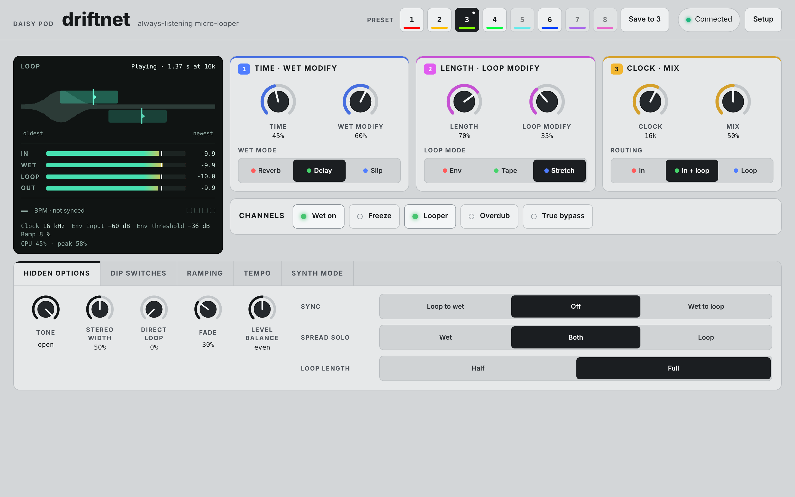
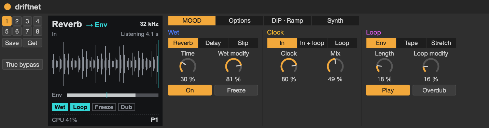

# Driftnet

A two-channel micro-looper and spatial effect, after Chase Bliss's MOOD MKII.
The **Wet Channel** is a real-time effect. The **Micro-Looper** is always
listening, so when you switch it on it loops whatever you just played,
like casting a net. The two channels feed each other, and the **CLOCK** sets
the sample rate both run at.

```sh
make APP=driftnet program-dfu
```

Everything the pedal hides behind its toggles, DIP switches and hidden menu
is here too: over MIDI with MOOD's own CC map, or from the
[web page](#the-web-page). The Pod's controls cover the knobs, toggles and
footswitches. Eight [presets](#presets) are kept in flash, and the hidden
options and DIP switches are saved as you set them.

## The CLOCK

CLOCK sets the sample rate of everything except the dry signal. It goes from
2k to 64k in MOOD's steps: 2k, 3k, 4k, 6k, 8k, 12k, 16k, 24k, 32k, 48k
and 64k. The steps alternate fifths and fourths, so every change stays in
harmony. The loop and the delay are a fixed number of samples, so the CLOCK
sets several things at once:

- **Length:** a lower clock means a longer loop and a longer delay. The loop is
  2 s at 64k, 2.7 s at 48k and 65 s at 2k.
- **Pitch:** anything already recorded plays slower and lower when you turn
  the clock down. Overdubs keep the speed they were recorded at.
- **Grit:** there's no anti-alias filter, so low settings alias heavily.

With the SMOOTH DIP switch on, CLOCK glides anywhere between 2k and 64k
instead of stepping, for fine tuning and atonal harmonies. Synth Mode plays
the clock from a keyboard (see [Synth Mode](#synth-mode)).

## Controls

The two knobs are shared across three pages, one for each column of the
pedal. Press the encoder to change page (LED 2 shows which). After a page
change a knob does nothing until it is moved, so values don't jump.

| Page | LED 2 | Knob 1 | Knob 2 | Encoder turn |
|---|---|---|---|---|
| 1 Wet | Blue | TIME | MODIFY | Reverb, Delay, Slip |
| 2 Loop | Magenta | LENGTH | MODIFY | Env, Tape, Stretch |
| 3 Global | Yellow | CLOCK: 2k to 64k | MIX: dry and wet, both at full at noon | Routing |

What TIME, LENGTH and the two MODIFYs do depends on the mode; see
[The Wet Channel](#the-wet-channel) and [The Micro-Looper](#the-micro-looper).
Turning the encoder moves the page's three-way toggle, and LED 2 flashes
red, green or blue for left, middle or right. It starts on Delay, Tape and
In.

A limiter holds dry plus wet under -1 dBFS.

| Control | Function |
|---|---|
| Button 1 | Wet Channel on; tap again for off |
| Button 1 hold | Freeze while held (with LATCH, until held again) |
| Button 2 | Micro-Looper: play the last moments; tap again to go back to listening |
| Button 2 hold | Overdub while held (with LATCH, until held again) |
| Encoder press | Next page |
| Encoder long press | Mono in (the MISO DIP switch): the left input feeds both channels (LED 1 flashes cyan for on, dark for off). On the preset page, it saves instead |
| Page 4 (LED 2: the slot) | Presets: the encoder turn selects a slot (see [Presets](#presets)) |

**LED 1** is green while the Wet Channel is on and white while it's frozen,
with red added while the loop plays (so both on shows yellow). It blinks
off at the start of each pass, and its red flickers while overdubbing. In
Synth Mode it's cyan, brighter while a note sounds, and it blinks red while
[truly bypassed](#true-bypass).

### Routing

Routing decides what the Wet Channel processes while the loop plays. Turn the
encoder on page 3.

| Position | LED 2 flash | The Wet Channel hears |
|---|---|---|
| In | Red | Your input only; the loop stays clean |
| In + Loop | Green | Your input and the loop |
| Loop | Blue | The loop only; your input stays dry |

A loop sent through the Wet Channel is heard only through it, unless
DIRECT MICRO-LOOP blends some of the clean loop back in.

## The Micro-Looper

It never stops recording while it's off. Switching it on loops the last
loop's worth, ending the moment you pressed. Switching it off again starts
recording over the loop, oldest first, so you can switch it off and straight
back on to catch new material. For example, run a loop through the Delay,
then switch the looper off and on to record the echoes into it.

While the looper is off, it records the Wet Channel as well as your input,
so trails end up in the loop. Overdubs take only your clean input; anything
else would feed the loop back into itself through the effect.

Switching between the looper's modes keeps the loop. Overdubs are written
wherever the play head is, so anywhere but Tape at 1x they can land
somewhere unexpected. FADE lets each overdub pass fade the loop, and NO DUB
replaces it outright, for a pseudo-live effect that follows your playing
(more closely at higher clock rates). LOOP LENGTH can halve the loop, as on
the first MOOD, and SYNC can set it from TIME.

| Mode | LENGTH | MODIFY |
|---|---|---|
| Env | Slice size, 5 ms to 1 s | Sensitivity: how quietly you can play to hold a slice |
| Tape | Shortens the loop to as little as 1/32, keeping its newest end | Speed: 4x, 2x, 1x or 0.5x, reversed below noon and forward above |
| Stretch | Grain size, 2 ms (grainy) to 1 s (clear, with repeating phrases) | Stretch: frozen at noon, less stretched further out, none at either end (reversed at min) |

**Env mode** cuts the loop into slices and plays it at 1x. While your input
is louder than the threshold, it repeats the slice it's in, until you stop.
Turn MODIFY up and touch the strings lightly to slow the loop to a crawl
without being heard.

**Tape mode** changes speed in octaves. Use it to offset the CLOCK: lower the
clock for grit, then speed the loop back up.

**Stretch mode** plays two overlapping grains at 1x, while the place they
read from moves through the loop more slowly. It's stretched 1.5x, 2x and
then 4x on the way towards noon, where it stops and repeats one grain;
LENGTH then shrinks or grows that moment. Below noon it runs backwards. The
steps follow MOOD's MIDI chart, with the knob moving smoothly between them.
To get to know it, set LENGTH and MODIFY to max, turn MODIFY slowly towards
noon, then turn LENGTH down.

**SPREAD** (the DIP switch, unless SPREAD SOLO keeps it to the Wet Channel)
gives each mode a stereo movement: Env pans side to side while it holds a
slice, Tape plays the loop forwards on the right and backwards on the left,
and Stretch pans slowly, faster the less it's stretched.

**CLASSIC** brings back some of the first MOOD's flaws: the loop wears a
little on every pass, getting duller and rounder; Tape's LENGTH chops the
loop instead of shortening it; and with NO DUB the loop is muted while you
overdub, so holding the button records and releasing plays back.

## The Wet Channel

Changing mode fades out, then fades in the new one with nothing in it, so
old echoes don't come back.

| Mode | TIME | MODIFY |
|---|---|---|
| Reverb | Size and decay, 30 ms to 500 ms at 48k | Smear: clean multi-tap at min, reverb at max |
| Delay | Delay time, 1 ms to 2.7 s at 48k | Feedback, holding like a looper at max |
| Slip | Sampling window, 5 ms to 2 s at 48k | Speed in semitones: 1x forward at noon, up to 2x forward, or 1x to 2x reversed below noon |

**Reverb mode:** a dense cluster of echoes, eight taps a side, which the
smear turns into a wash. Each pass of the feedback smears it further.
Moving TIME slides the taps, which bends the pitch of what's sounding.
Freeze holds it, and turning MODIFY up while frozen smears it further.

**Delay mode:** a clean delay. Changing TIME crossfades to the new time
instead of bending the pitch of the echoes. At maximum MODIFY the feedback is
exactly 1, so the repeats hold and pile up like a looper. Turning TIME slowly
while they hold records a stretch into them. Freeze cuts the input and holds
whatever is repeating.

**Slip mode:** samples your input continuously and plays its newest moments
back at another speed. Short windows make it a pitch shifter; long ones
make harmonised phrases that follow behind you. Each window keeps the
speed it started with, so turning MODIFY steps the harmony. Freeze stops
the sampling, so it repeats the same window like a synth note. Try a loop
routed through it, moving MODIFY as you punch it in and out.

**SPREAD**, unless SPREAD SOLO keeps it to the loop, as wide as STEREO
WIDTH: the Reverb scatters its taps across the stereo field, the Delay
ping-pongs, mirroring where your input sits, and Slip pans side to side once
every two windows. **CLASSIC** makes the Reverb ring a little, the Delay's
TIME bend the pitch of the echoes, Slip crunchier, and the clock hiss more
as it comes down.

**TONE** is a hi-cut on the Wet Channel only, from open down to 800 Hz. It
stays put in Hz whatever the CLOCK. With **TRAILS**, switching the Wet
Channel off lets what's sounding ring out.

## Hidden options and DIP switches

None of these have Pod controls. Set them over MIDI or from the
web page.

| Hidden option | CC | Values | Default |
|---|---|---|---|
| STEREO WIDTH: how wide SPREAD is on the Wet Channel | 24 | 0-127 | 127 |
| FADE: how much of the loop each overdub pass keeps (down to 30%) | 26 | 0-127 | 127 |
| TONE: the Wet Channel's hi-cut | 27 | 0-127 | 127 (open) |
| LEVEL BALANCE: below noon turns the loop down, above it the Wet Channel | 28 | 0-127 | 64 (even) |
| DIRECT MICRO-LOOP: clean loop blended back when it's routed through | 29 | 0-127 | 0 |
| SYNC: loop to wet, off, wet to loop (see [Tempo and sync](#tempo-and-sync)) | 31 | 0-1, 2, 3+ | off |
| SPREAD SOLO: SPREAD on the Wet Channel only, both, or the loop only | 32 | 0-1, 2, 3+ | both |
| LOOP LENGTH: half or full | 33 | 0-1, 2+ | full |

| DIP switch | CC | Default |
|---|---|---|
| CLASSIC | 71 | off |
| MISO: mono in, stereo out (also the encoder's long press) | 72 | off |
| SPREAD | 73 | off |
| DRY KILL: no dry signal at all, even in bypass | 74 | off |
| TRAILS | 75 | off |
| LATCH: the two holds toggle | 76 | off |
| NO DUB | 77 | off |
| SMOOTH: CLOCK glides instead of stepping | 78 | off |

## Ramping

MOOD's left bank of DIP switches automates the knobs. Pick which ones move
(TIME, wet MODIFY, CLOCK, loop MODIFY, LENGTH: CCs 61-65). With **BOUNCE**
(66) they sweep back and forth for as long as it's on; without it they ramp
once, each time a channel is switched on, from the far end of their range to
where the knob is. **SWEEP** (67) sets the range: from the bottom up to the
knob, or from the knob up to the top. **POLARITY** (68) turns the movement
over.

RAMP SPEED (CC 20) goes from one cycle every 50 s to 10 a second, and
RAMPING WAVEFORM (CC 25) morphs from triangle through square, sine and
random to smoothed random. CC 52 at 0 stops the movement where it is and
anything above resumes it. On the pedal MIX becomes the ramp speed; here MIX
stays on the Pod and the speed is set over MIDI or from the page.

**Expression over MIDI** (CC 100) takes over the chosen knobs across the
same range. With none chosen it controls MIX, as on the pedal.

## Tempo and sync

Driftnet follows MIDI clock (after a MIDI Start or Continue) unless CC 51 is
0, or takes a tempo from taps on CC 93 or 107 (or the page). Once it has a
tempo, TIME (in Delay and Slip) moves in note values, in MOOD's steps: 1/32,
1/16, 1/8 triplet, 1/8, dotted 1/8 and 1/4. In Tape mode LENGTH steps
through fractions of a note value, 1/32 of it up to the whole, keeping the
newest end of the loop, so a loop caught on the beat plays in time. The
page's Synced switch forgets a tapped tempo.

The clock divisions set those note values. Each is 1/32, 1/16, 1/8
triplet, 1/8, dotted 1/8, 1/4, 1/2 or a whole note (CC values 0-7), and
both start at a quarter note:

- **TIME division** (CC 53) multiplies TIME's steps. A quarter note leaves
  them as they are, a half note doubles them, and an eighth halves them.
- **LENGTH division** (CC 54) is the note value Tape's LENGTH is a fraction
  of: at full LENGTH the loop is one of them.

A time too long for the delay, or a length too long for the loop, halves
until it fits, as on MOOD.

The SYNC hidden option ties the two channels together:

- **Loop to wet:** the loop is as long as TIME, so if your playing is in time
  with the Delay, the loop captures it in time.
- **Wet to loop:** TIME steps through fractions of the loop (1/32, 1/16, 1/8,
  1/6, 1/4, 1/3, 1/2, all of it), so the echoes land in time with it.

## True bypass

MOOD can bypass through a relay instead of its buffer. Here the TRUE BYPASS
setting (CC 55 at 1 or more, or the page's switch) does the same whenever
both channels are off: the dry signal passes untouched, TRAILS are cut, and
the always-listening looper stops listening, as on the pedal. LED 1 blinks
red while it's truly bypassed. Switching either channel on brings it all
back; the loop you catch then is from before you bypassed.

## Synth Mode

Playing a MIDI note turns the CLOCK into an instrument. Notes
set the clock in semitones: middle C is 48k, where everything plays at the
pitch it was recorded at, and the clock's range (2k to 64k) sets how far a
note can go. Notes are monophonic, last note first. Moving the CLOCK knob,
or CC 59, leaves Synth Mode; MIDI clock is ignored while it's on.

| Setting | CC | Values |
|---|---|---|
| OCTAVE TRANSPOSE | 57 | 0-9 octaves; 3 puts middle C at 48k |
| OUTPUT TYPE: open (always sounding), on/off (while a key is down), or ADSR | 58 | 0, 1, 2+ |
| ATTACK, DECAY, SUSTAIN, RELEASE | 80-83 | 0-127 |
| PORTAMENTO | 84 | 0-127, up to 2 s |
| Pitch bend | | 4 semitones either way |
| Mod wheel: vibrato | 1 | 0-127 |

On/off and ADSR follow velocity, and only gate the Wet Channel and the loop;
your dry signal always passes. A frozen Reverb or a Stretch loop makes a
good first sound.

## MIDI

On the Pod's TRS MIDI input and over USB, on every channel for now (MOOD
listens on channel 2 by default). Knob CCs move the value with the same
takeover as a page change, so the physical knob does nothing until you move
it.

| What | CC | Values |
|---|---|---|
| TIME, MIX, LENGTH, wet MODIFY | 14, 15, 16, 17 | 0-127 |
| CLOCK | 18 | MOOD's stepped table (0-4 2k ... 122-127 64k), or 0-127 with SMOOTH |
| Loop MODIFY | 19 | 0-127 (Tape and Stretch follow MOOD's tables) |
| Wet mode, routing, loop mode | 21, 22, 23 | 0-1 left, 2 middle, 3+ right |
| Wet Channel on, looper on | 102, 103 | 0 off, 1+ on |
| Freeze, overdub | 105, 106 | 0 off, 1+ on |
| Tap tempo | 93, 107 | 1+ |
| Follow MIDI clock | 51 | 0 ignore, 1+ follow |
| TIME and LENGTH clock divisions | 53, 54 | 0-7: 1/32 to a whole note |
| True bypass | 55 | 0 buffered, 1+ true |
| MIDI reset: follow clock, quarter-note divisions, octave 3, no portamento, open output | 110 | any |

The hidden options, DIP switches, ramping and Synth Mode CCs are above.
**Program change** 1-8 recalls preset 1-8, as on MOOD; 0 does nothing.
**Factory reset** (CC 56, any value) erases the presets and saved settings
(see [Presets](#presets)). Not used: saving a preset over MIDI, the hidden
menu switch (104) and choosing a MIDI channel.

## Presets

Eight preset slots, kept in the Seed's flash, so they survive power-off and
reflashing. Every app keeps its own.

- **On the Pod:** page 4 is the preset page. Turning the encoder there
  selects a slot and loads its preset; an empty slot is only selected,
  keeping the sound, ready to save into. A long press on the encoder saves
  the current settings to the slot. The knobs do nothing on this page.
  LED 2 shows the slot: a colour each, dim if empty, blinking off while the
  sound differs from what's saved, and flickering white on a save. Before
  any slot is selected it's dim white.
- **Over MIDI:** program change 1-8 recalls preset 1-8, as on MOOD; 0 does nothing.
- **On the web page:** a button per slot, and Save. Selecting the slot
  already selected reloads it, dropping any changes.

A preset holds the knobs, the three toggles, ramping (its settings and whether it runs), the TIME and LENGTH clock divisions, and Synth Mode's settings. The hidden options, the DIP switches, TRUE BYPASS and Follow MIDI clock are saved on their own, a few seconds
after they last change. At power-up they come back, then the preset last
selected. The channels, freeze, overdub, tempo, expression and Synth Mode itself always start from scratch.

**Factory reset:** hold both buttons while powering up the Pod (through
the bootloader's 2.5 s wait) until both LEDs flash white, then let go. Or
press Factory reset on the web page, or send CC 56 (any value), as on MOOD. Every preset and saved setting
for this app is erased (the other apps keep theirs) and everything goes
back to its defaults.

## The web page

`make web` and open http://localhost:8000 with the Pod on USB (see
[web/README.md](../../web/README.md)). It shows every control, option and
switch, the levels (in, wet, loop, out) and CPU, traces of the clock, Env's
detector against its threshold and the ramp, and the loop: the ring filling
while the looper listens, then the loop with what's playing it (Tape's
window, Env's slice, Stretch's grains) and its play heads. The deep
settings (hidden options, DIP switches, ramping, tempo and Synth Mode) are
in a drawer under the knob pages, a tab at a time.



For Ableton Live, `make m4l` builds a Max for Live device for it: every
parameter as a Live parameter you can automate and map, kept in sync with
the Pod both ways. See [m4l/README.md](../../m4l/README.md).



*A render of the device's layout, not a capture from Live: Live draws its own controls a little differently.*
