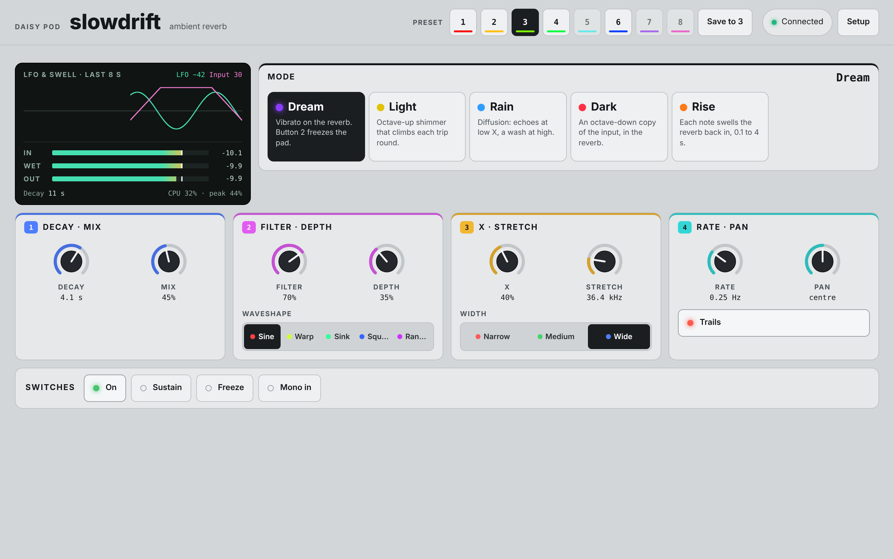

# Slowdrift

A stereo ambient reverb, our own take on Walrus Audio's Slöer. It's a
modulated plate with five modes. Each mode gives the **X** control its own
job, and **Stretch** lowers the reverb's sample rate for longer, darker and
grittier tails.

```sh
make APP=slowdrift program-dfu
```

Every control is also over MIDI (see [MIDI](#midi)) and on the
[web page](#the-web-page). Eight [presets](#presets) are kept in flash.

## Signal flow

```
in -+------------------------------------------------------------- dry -+
    |                                                                    |
    +-> gate (on/off, Freeze) x Rise's swell                             |
        -> at Stretch's rate (48 kHz down to 12 kHz):                    |
             [Dark: + the input an octave down]                          |
             -> plate, modulated by the LFO                              |
                [Light: an octave up inside its loop]                    |
             -> Width -> [Dream: vibrato] -> the mode's low-pass         |
        <- back to 48 kHz -> wet                                         |
    mix and pan <--------------------------------------------------------+
    -> limiter -> out
```

## Modes

| Mode | LED | X |
|---|---|---|
| Dream | Violet | Vibrato on the reverb. Button 2 freezes the pad: the input is shut out and the tail held until you press again, when it fades away at the Decay setting |
| Light | Pale gold | Octave-up shimmer. Each trip round the plate's loop goes up another octave, so tails climb |
| Rain | Sky blue | Diffusion. Low X takes the plate's diffusers out, leaving its delay taps as audible echoes; high X smooths them into a wash |
| Dark | Red | The level of an octave-down copy of the input, fed into the reverb |
| Rise | Orange | Swell time, 0.1 s to 4 s. Each note shuts the reverb's input off and swells it back in, so the reverb blooms behind the note while earlier tails ring on |

## Controls

The two knobs are shared across four pages. Press the encoder to change
page (LED 2 shows which). After a page change a knob does nothing until you
move it, so values don't jump. Turning the encoder sets that page's choice,
and LED 2 flashes it for a second.

| Page (LED 2) | Knob 1 | Knob 2 | Encoder turn |
|---|---|---|---|
| 1 (blue) | Decay: 0.3 s to 20 s | Mix: dry to wet, equal power | Mode: Dream, Light, Rain, Dark, Rise (LED 2 flashes the mode's colour) |
| 2 (magenta) | Filter: the mode's low-pass, dark to bright | Depth: modulation, none to seasick | Waveshape: sine, warp, sink, square, random (a hue each) |
| 3 (yellow) | X: the mode's job (above) | Stretch: the reverb's sample rate, 48 kHz down to 12 kHz | Width: narrow, medium, wide (red, green, blue) |
| 4 (cyan) | Rate: the LFO, 0.05 Hz to 10 Hz. LED 1 pulses with it on this page | Pan: the wet to one side and the dry to the other. Noon is centred | Trails: on or off (green, red) |

| Control | Function |
|---|---|
| Encoder press | Next page |
| Encoder long press (0.6 s) | Mono in: the left input feeds both channels. LED 1 flashes cyan for on, dark for off. On the preset page, it saves instead |
| Page 5 (LED 2: the slot) | Presets: the encoder turn selects a slot (see [Presets](#presets)) |
| Button 1 | On/off. Pressed while off, the effect comes on at once. Let go within 0.4 s and it stays on; hold it longer and it goes off again when you let go (smart bypass). Pressed while on, it goes off when you let go |
| Button 2 | Sustain: the decay stretches to 60 s while held, then eases back. In Dream, a press freezes the pad and another releases it |

LED 1 shows the mode's colour while the effect is on and is dark while it's
off. It glows white while Sustain or Freeze holds the tail.

With **trails** on (the default), turning the effect off shuts the reverb's
input and lets the tail ring out under the dry signal. With trails off, the
tail is cut in 5 ms.

Starting values: Dream, decay 3 s, mix 40%, filter 60%, a little sine
modulation at 0.4 Hz, X 40%, no stretch, wide, trails on.

## Waveshapes

The LFO moves the delay inside the plate's two modulated allpasses, a
quarter cycle apart. Depth sets how far, and Rate how fast. A falling delay
bends the pitch up:

| Shape | |
|---|---|
| Sine | Smooth and even, up and down |
| Warp | Falls fast and rises slowly: quick bends up, like a warped record |
| Sink | Falls slowly and rises fast: quick dips down, like a Bigsby arm |
| Square | Jumps between the ends. The jumps chirp (a 4 ms slew stops them clicking) |
| Random | A new random level each cycle, sample-and-hold style |

Dream's vibrato uses the same shape on its own LFO, from 2 Hz to 8 Hz as
Rate goes up.

## Stretch

Stretch runs everything after the input gate at a lower sample rate, two
octaves down at most (48 kHz to 12 kHz), as the Slöer does with its DSP chip.
The plate's lines are a fixed number of samples, so:

- **Decay** gets longer: at full Stretch, every decay time is four times
  longer.
- **Tone** gets darker: the reverb's bandwidth falls with the rate.
- **Grit:** there's no anti-alias filter, so low rates alias.

Moving Stretch while a tail rings bends its pitch, like a tape slowing down.

## Width

| Width | |
|---|---|
| Narrow | The same reverb on both sides (parallel mono) |
| Medium | Some of the plate's stereo spread |
| Wide | Full spread, and the left and right inputs go into the plate's two halves separately |

Narrow and medium make up the level they lose.

## MIDI

The Slöer has no MIDI, so this map is our own. Slowdrift listens on every
channel, on the Pod's TRS MIDI input and over USB. A CC that sets a knob's
value takes over from the Pod's knob, which does nothing until you move it
again.

| CC | Control | Values |
|---|---|---|
| 14 | Decay | 0-127 |
| 15 | Mix | 0-127 |
| 16 | Filter | 0-127 |
| 17 | Depth | 0-127 |
| 18 | X | 0-127 |
| 19 | Stretch | 0-127 |
| 20 | Rate | 0-127 |
| 21 | Pan | 0-127, 64 is centred |
| 22 | Mode | 0-25 Dream, 26-51 Light, 52-76 Rain, 77-102 Dark, 103-127 Rise |
| 23 | Waveshape | 0-25 sine, 26-51 warp, 52-76 sink, 77-102 square, 103-127 random |
| 24 | Width | 0-42 narrow, 43-85 medium, 86-127 wide |
| 25 | Trails | 0-63 off, 64-127 on |
| 64 | Sustain pedal | Works like button 2: down (64-127) and up (0-63). Sustain while down, or in Dream, each press freezes the pad or lets it go |
| 102 | On/off | 0-63 off, 64-127 on |
| 103 | Freeze (Dream only) | 0-63 off, 64-127 on |
| 104 | Mono in | 0-63 off, 64-127 on |

**Program change** 1-8 (sent as 0-7) selects preset slot 1-8.

The choices split 0-127 evenly, so a controller's knob sweeps through them.
LED 2 flashes a choice changed over MIDI only if its page is showing.

## Presets

Eight preset slots, kept in the Seed's flash, so they survive power-off and
reflashing. Every app keeps its own.

- **On the Pod:** page 5 is the preset page. Turning the encoder there
  selects a slot and loads its preset; an empty slot is only selected,
  keeping the sound, ready to save into. A long press on the encoder saves
  the current settings to the slot. The knobs do nothing on this page.
  LED 2 shows the slot: a colour each, dim if empty, blinking off while the
  sound differs from what's saved, and flickering white on a save. Before
  any slot is selected it's dim white.
- **Over MIDI:** program change 1-8 (sent as 0-7) selects slot 1-8.
- **On the web page:** a button per slot, and Save. Selecting the slot
  already selected reloads it, dropping any changes.

A preset holds the knobs, mode, waveshape and width. Trails and mono in are saved on their own, a few seconds
after they last change. At power-up they come back, then the preset last
selected. On/off, Sustain and Freeze always start from scratch.

**Factory reset:** hold both buttons while powering up the Pod (through
the bootloader's 2.5 s wait) until both LEDs flash white, then let go. Or
press Factory reset on the web page. Every preset and saved setting
for this app is erased (the other apps keep theirs) and everything goes
back to its defaults.

## The web page

Run `make web` and open http://localhost:8000 in Chrome or Edge with the Pod
connected by USB. The page shows the in, wet and out levels, CPU, and traces
of the LFO, the reverb's input gain and the decay time. The input gain trace
shows Rise's swells and the gate closing for off and Freeze. The decay trace
shows Sustain and Freeze stretching the decay, and Stretch lengthening it.
Every control is there too. See [web/README.md](../../web/README.md).



For Ableton Live, `make m4l` builds a Max for Live device for it: every
parameter as a Live parameter you can automate and map, kept in sync with
the Pod both ways. See [m4l/README.md](../../m4l/README.md).
