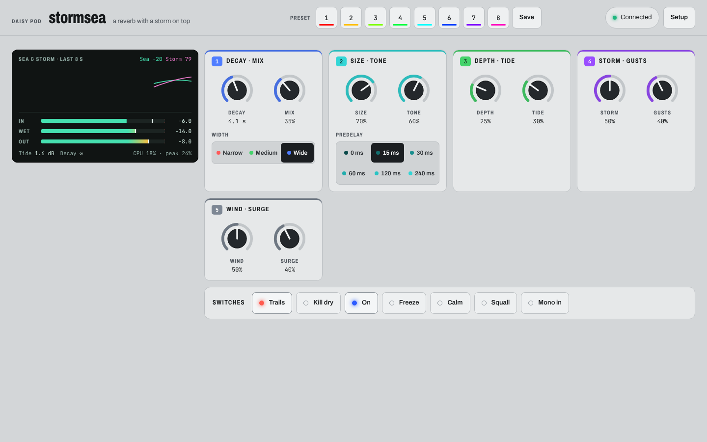
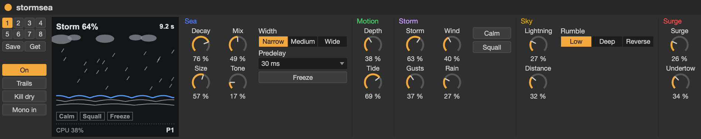

# Stormsea

A stereo reverb named after Oceanus Procellarum, the Ocean of Storms on the
Moon: a dark, glassy plain named for weather it never has. With the storm
down it's a clean, lush reverb whose tails run from half a second to
forever. Turn **Storm** up and weather rolls across the tail: wind churns
it, the sea surges and boils, lightning flashes and thunder rolls in
after it, near or far, rain falls on it, and an undertow drags it down. **Gusts**
makes the storm come and go on its own. The storm only touches the wet
signal: the dry passes clean.

This is our own design, not modelled on a pedal.

```sh
make APP=stormsea program-dfu
```

Every control is also over MIDI (see [MIDI](#midi)) and on the
[web page](#the-web-page). Eight [presets](#presets) are kept in flash.

All four stages of the [Roadmap](#roadmap) are built and running on the
Pod: **the calm sea**, a reverb with Freeze, presets, MIDI and the web
page, and **the storm**: Storm and Gusts, Wind, Rain, Lightning and its
thunder, Surge and Undertow, and Calm and Squall on the buttons, with a
view of the sea on the web page. Tuning by ear has begun (the wet level,
and lightning and thunder); the rest of the storm's ranges are still to
tune.

## Signal flow

```
in -+---------------------------------------------------------------- dry -+
    |                                                                       |
    +-> gate (on/off, Freeze) -> low cut -> predelay -> input diffusers     |
        -> the sea: 8 delay lines, each                                     |
             delay (Size; Depth and Wind move it)                           |
             -> damping (Tone; Surge stretches the decay)                   |
             -> DC block -> Surge: gain past unity, soft clip               |
             -> Undertow: turning -> mixing matrix -> Undertow: sinking     |
             -> sea wall -> back into the lines x Decay                     |
           <- Thunder rolls in, Rain falls in                               |
        -> the tail ring: what Rain and Thunder play                        |
        -> Width -> Tone (while held) -> Wind: whistle                      |
        + Rain and Thunder -> Tide -> wet                                   |
    mix <-------------------------------------------------------------------+
    -> limiter -> out
```

Wind, Rain, Lightning and Thunder, Surge and Undertow are the storm,
scaled by Storm's strength from moment to moment: at Storm 0 they don't
run and the sea is calm.

## The calm sea

The reverb is a feedback delay network: eight delay lines of different
lengths (21 ms to 137 ms at full Size), whose outputs are mixed by a matrix
and fed back into them all. The matrix is orthogonal, so it moves energy
between the lines without adding or losing any. That makes it clean (no
metallic ring at long decays, and dense from the first moment, thanks to
the input diffusers), and it makes an infinite tail hold its level: frozen
for five minutes, it moves by a fraction of a dB to a few dB, depending on
Depth.

| Control | |
|---|---|
| **Decay** | 0.5 s to 60 s, then **∞** over the knob's last stretch. At ∞ the sea keeps everything you play and layers it, under the sea wall. A longer decay piles up more tail, so the sea's input is turned down as Decay goes up: at full wet, a tail sits about 7 dB under what you play at short decays and about 2 dB under at 60 s, and an ∞ sea settles about level with it |
| **Mix** | Dry to wet, equal power |
| **Size** | The lines' lengths, 30% to 100%: from a hall to a vast open sea. Moving it while the sea rings bends the tail's pitch, as the waves stretch |
| **Tone** | Damping inside the loop, dark to bright: the top dies away in 10% (dark) to 70% (bright) of the decay time. At ∞ and in Freeze it moves to a low-pass on the output instead (1.5 kHz to 16 kHz), so a held sea keeps its colour rather than darkening to a hum |
| **Depth** | Slow, gentle swings in the lines' lengths, each at its own rate (0.13 Hz to 0.61 Hz), for a lusher tail with no audible wobble. At 0 it's still and pure |
| **Tide** | The sea's own motion: slow swells in the tail's level (up to ±4 dB) and stereo position, each move taking 5 s to 15 s, at random. Tide is the calm sea's, so Storm won't scale it |
| **Predelay** | 0, 15, 30, 60, 120 or 240 ms before the sea. A change fades from the old to the new in 30 ms |
| **Width** | Narrow (the same tail on both sides), medium, or wide (the inputs go into the sea separately and it spreads them) |

The **sea wall** is a slow level control inside the loop that holds the
sea under a ceiling, and the ceiling follows what you play: it rises with
the input in 50 ms and falls over 20 s, but only while something's coming
in, so when you stop playing (or freeze, or switch off) it stays put and
an infinite sea holds. You only meet it at ∞, at long decays under steady
playing, frozen with a storm feeding in, or with Surge up: it rides the
level down gently each trip rather than clipping. A low cut at 50 Hz on the way
in keeps the sea from filling with rumble, and a DC block in the loop keeps
it centred.

## The storm

**Storm** sets how strong the storm is, from calm to gale. Each element's
own control sets its part in the storm, so a preset can be all wind and
rain, or a thunderstorm, or a swelling, boiling sea: Storm then scales
them all together. At Storm 0 every element is off, whatever its setting.

**Gusts** sets how the storm moves. At 0 it holds steady at Storm's
setting. Turned up, it comes and goes on its own: fronts that build and
pass over 10 to 40 s swing it up to 90% above and below Storm's setting,
and sudden gusts (0.4 s to 2.5 s) lift it up to 80% more, so a medium
storm has lulls of near calm and gusts near full. Gusts runs free, with no
tempo, like weather. LED 1 and the web page show the storm's strength from
moment to moment.

**Calm** (button 1 held) eases the storm down to nothing over a couple of
seconds, and lets it back when you let go. **Squall** (button 2 held)
raises it to full in a moment, each element to its own setting, and lets
it fall back over a few seconds when you let go.

| Element | What it does |
|---|---|
| **Wind** | Turbulence: each line's length wanders at random, by up to 5 ms each way and in moves of 1.5 s down to 0.1 s as the wind rises, so the tail's pitch smears and churns (up to a couple of semitones in a gale). And the whistle: a resonant band-pass on the tail, 400 Hz to 2.4 kHz, sweeping at random and lifted by the gusts, a little higher on the right, like wind through rigging |
| **Rain** | Drops: tiny grains (2 to 20 ms) of the last half second of the tail, through a high-pass at 600 Hz, at a random pitch (unison, a fifth or an octave up), position and level, from 2 a second to a downpour of 250 (with the square of the setting, so a little rain is a few drops). The drops fall into the sea as well as being heard, so rain leaves a shimmer in the tail |
| **Lightning** | How often it strikes, at random, from none to about one strike every 2 s in a full storm, up to three times as often in a gust. A strike is silent, as lightning is: LED 1 flashes white and the web page draws a bolt. Each one keeps a slice of the tail as it was, for its thunder |
| **Distance** (thunder) | How far off the storm is, so how long until each strike's thunder: 0.15 s near to 5 s far, each strike's varying by up to 30% either way. The distance shapes the thunder as it would outdoors. Near, it plays 0.12 s of tail, bright (two low-passes at 900 Hz), with a sharp attack, about level with the tail. Far, it plays 0.7 s, dark (120 Hz), swelling in over its first 40% and rolling away, about 11 dB under the tail. Its level wavers as it rolls. What it plays is the Rumble choice, below. Without lightning there's no thunder |
| **Surge** | Stretches the decay towards ∞, so the tail swells and lingers; past 30% of it, it also raises the sea's gain past unity (by up to 12% a trip) into a soft clipper in each line (about 6 dB over the sea wall, so it boils at any playing level), so the tail swells up, thickens and boils instead of dying away. When the storm drops the gain falls back under unity and the sea settles to its Decay |
| **Undertow** | Turns four pairs of lines (each a short one with a long one) into each other by angles that wander, up to about 57° each way, each move taking 4 to 12 s, so the tail's colours shift and churn as energy moves between lengths. The turning is orthogonal, so an infinite sea stays stable. And it sinks the tail: two lines' feed passes a frequency shifter, lowering every partial by up to 0.6 Hz each trip, so long tails slide down into the deep. A frozen sea under a strong undertow slowly sinks out of hearing: at full, an A at 440 Hz reaches the bottom in about three minutes |

**Rumble** chooses what thunder plays:

| Rumble | |
|---|---|
| Low | The slice an octave down, so twice as long |
| Deep | Two octaves down, four times as long: rolls on for nearly 3 s when far |
| Reverse | An octave down and reversed: it swells in towards you over most of its length and stops short |

## Weathering

Freeze shuts the input out and holds the sea forever. Let go of Freeze and
it fades away at the Decay setting.

The storm keeps working on a frozen sea, and what it does stays:
thunder and rain leave new partials in it, Surge wears it round,
Wind smears it, and Undertow turns it and drags it down. Freeze a chord,
raise a storm, and when the calm comes back the sea isn't the one you
froze.

## Controls

The two knobs are shared across seven pages. Press the encoder to change
page (LED 2 shows which). After a page change a knob does nothing until you
move it, so values don't jump. Turning the encoder sets that page's choice,
if it has one, and LED 2 flashes it for a second.

| Page (LED 2) | Knob 1 | Knob 2 | Encoder turn |
|---|---|---|---|
| 1 Sea (blue) | Decay | Mix | Width: narrow, medium, wide (red, green, blue) |
| 2 Shape (cyan) | Size | Tone | Predelay: 0 to 240 ms (dim to bright) |
| 3 Motion (green) | Depth | Tide | |
| 4 Storm (violet) | Storm | Gusts | |
| 5 Wind and Rain (white) | Wind | Rain | |
| 6 Lightning (yellow) | Lightning | Distance | Rumble: Low, Deep, Reverse (amber, red, violet) |
| 7 Surge (red) | Surge | Undertow | |
| 8 (the slot) | | | Presets: selects a slot (see [Presets](#presets)) |

| Control | Function |
|---|---|
| Encoder press | Next page |
| Encoder long press (0.6 s) | Mono in: the left input feeds both channels. LED 1 flashes cyan for on, dark for off. On the preset page, it saves instead |
| Button 1 tap | On/off, when you let go. With trails on (the default), turning it off shuts the sea's input and lets the tail ring out under the dry signal; with trails off, the tail is cut in 5 ms |
| Button 1 hold | **Calm**: the storm dies down over a couple of seconds while held, and comes back when you let go |
| Button 2 tap | **Freeze**, when you let go: holds the sea forever, until you tap again (see [Weathering](#weathering)) |
| Button 2 hold | **Squall**: the storm rises to full in a moment while held, and falls back to its setting over a few seconds when you let go. Frozen or not |

The buttons act when you let go (within half a second), so that a hold can
do something else.

LED 1 is dark while the effect is off. While it's on, it shows the storm's
strength from moment to moment, from a calm deep blue through grey to a
stormy violet, and flashes white at each lightning strike. It glows pale
moonlight white while the sea is frozen (strikes still flash).

Starting values: decay 4 s, mix 35%, size 70%, tone 60%, depth 25%, tide
0, predelay 15 ms, wide. Storm 0, gusts 40%, and the elements part way up
(wind 50%, rain 30%, lightning 30%, distance 50% so thunder comes about
0.9 s after each strike, Low, surge 40%, undertow 20%), so
turning Storm up brings a whole storm at once.

## MIDI

Stormsea listens on every channel, on the Pod's TRS MIDI input and over
USB. A CC that sets a knob's value takes over from the Pod's knob, which
does nothing until you move it again.

| CC | Control | Values |
|---|---|---|
| 14 | Decay | 0-127 (the top of the range is ∞) |
| 15 | Mix | 0-127 |
| 16 | Size | 0-127 |
| 17 | Tone | 0-127 |
| 18 | Depth | 0-127 |
| 19 | Tide | 0-127 |
| 20 | Storm | 0-127 |
| 21 | Gusts | 0-127 |
| 22 | Wind | 0-127 |
| 23 | Rain | 0-127 |
| 24 | Lightning | 0-127 |
| 25 | Distance | 0-127 |
| 26 | Surge | 0-127 |
| 27 | Undertow | 0-127 |
| 28 | Width | 0-42 narrow, 43-85 medium, 86-127 wide |
| 29 | Predelay | 0-21 0 ms, 22-42 15 ms, 43-63 30 ms, 64-85 60 ms, 86-106 120 ms, 107-127 240 ms |
| 30 | Rumble | 0-42 Low, 43-85 Deep, 86-127 Reverse |
| 64 | Sustain pedal | Freeze while down (64-127) |
| 102 | On/off | 0-63 off, 64-127 on |
| 103 | Freeze | 0-63 off, 64-127 on |
| 104 | Mono in | 0-63 off, 64-127 on |
| 105 | Calm | 64-127 while held, like button 1's hold |
| 106 | Squall | 64-127 while held, like button 2's hold |
| 107 | Trails | 0-63 off, 64-127 on |
| 108 | Kill dry | 0-63 off, 64-127 on: no dry at any Mix (or while off), for use on a send |

**Program change** 1-8 (sent as 0-7) selects preset slot 1-8.

The choices split 0-127 evenly, so a controller's knob sweeps through them.
LED 2 flashes a choice changed over MIDI only if its page is showing.

## Presets

Eight preset slots, kept in the Seed's flash, so they survive power-off and
reflashing. Every app keeps its own.

- **On the Pod:** page 8 is the preset page. Turning the encoder there selects a slot and
  loads its preset; an empty slot is only selected, keeping the sound,
  ready to save into. A long press on the encoder saves the current
  settings to the slot. The knobs do nothing on this page. LED 2 shows the
  slot: a colour each, dim if empty, blinking off while the sound differs
  from what's saved, and flickering white on a save. Before any slot is
  selected it's dim white.
- **Over MIDI:** program change 1-8 (sent as 0-7) selects slot 1-8.
- **On the web page:** a button per slot, and Save. Selecting the slot
  already selected reloads it, dropping any changes.

A preset holds the knobs, Width, Predelay and Rumble: the sea and its
weather. Mono in, Trails and Kill dry are saved on their own, a
few seconds after they last change. At power-up they come back, then the
preset last selected. On/off, Freeze, Calm and Squall always start from scratch.

**Factory reset:** hold both buttons while powering up the Pod (through
the bootloader's 2.5 s wait) until both LEDs flash white, then let go. Or
press Factory reset on the web page. Every preset and saved setting
for this app is erased (the other apps keep theirs) and everything goes
back to its defaults.

## The web page

Run `make web` and open http://localhost:8000 in Chrome or Edge with the Pod
connected by USB. The display shows a view of the sea: its surface rising
and falling with the tail's level and Tide and chopping with the wind,
clouds gathering as the storm rises, rain falling, a bolt and a lit sky at
each lightning strike (without the flash if your system asks for reduced
motion), thunder shaking the water, and along the top, the storm's
strength over the last minute. Under it are the in, wet and out levels,
Tide's swell, the decay time (∞ while the sea is held) and CPU. Every
control is there too, with Trails and Kill dry, and Calm and Squall as
switches. See
[web/README.md](../../web/README.md).



For Ableton Live, `make m4l` builds a Max for Live device for it: every
parameter as a Live parameter you can automate and map, kept in sync with
the Pod both ways. See [m4l/README.md](../../m4l/README.md).



*A render of the device's layout, not a capture from Live: Live draws its own controls a little differently.*

## Under the hood

- The Seed runs at 480 MHz, with block size 4.
- The sea (`sea.{h,cpp}`) is eight lines and eight input diffusers, 137 KB
  in RAM_D2 through the `.heap` section, as slowdrift's plate is: the loop
  reads about 24 times a sample, and SDRAM reads are slow. The predelay
  is in SDRAM, read once a sample.
- Each line's damping is a one-pole low-pass whose gains at DC and at
  Nyquist give that line the decay times asked for, so the tail darkens
  evenly whatever a line's length.
- The lines are read with first-order allpass interpolation, which passes
  every frequency at unity. Cubic interpolation dulls the top a little on
  each trip: a frozen sea lost everything above 8 kHz within seconds. The
  allpass clicks faintly when its whole-frame delay steps: below -90 dB at
  Depth's slow swings, and in a full gale, on a pure tone's tail, the
  energy above 6 kHz only rises from -66 dB to -62 dB of the whole, which
  the storm masks.
- Wind's turbulence is a `Wander` (`wander.h`) a line, stepped once a block
  and eased sample by sample in between. Surge's clipper is skipped while
  there's no Surge.
- The DC block in the loop is scaled so it never passes unity: unscaled,
  it lifts the very top by 0.025% each trip, and a frozen sea crept up 4
  dB in two minutes.
- Undertow's turning is four rotations between pairs of lines before the
  Hadamard matrix, their cos and sin renormalised each block (FastSin's
  0.1% would let a frozen sea creep). Its sinking is a single-sideband
  frequency shifter (`freq_shift.h`: two 4-section allpass chains 90°
  apart) on two lines' feed, which keeps the power whatever its phase
  error: a pitch shifter blended with the dry feed lost power wherever the
  two decorrelated, and drained a frozen sea in a minute. At 0 Hz the
  shifter is only an allpass, so it always runs.
- Rain and Thunder (`sky.{h,cpp}`) play from a ring of the sea's output,
  about 11 s (4 MB) in SDRAM, cleared once at boot: far thunder two
  octaves down reads up to 9.9 s back. Up to 12 drops and 8 thunders play
  at once (far thunder waits up to 6.5 s, so several are pending), each
  reading 2 frames a sample, by linear interpolation. Full rain sits about
  9 dB under the tail.
- Lightning was first heard as well as seen: each strike played its slice
  back an octave up or reversed, bright. It sounded odd, as lightning
  makes no sound of its own, so strikes are silent now and thunder, timed
  and shaped by Distance, is the sound.
- The web page's traces come every 2 ms rather than 1, so a frame of
  eight stays well under a message.
- Every element is free-running: its own random processes (`Wander`s),
  driven by the storm's strength, with no tempo.
- On the host the storm at full adds about 15% to the sea's time a sample:
  watch the CPU on the web page.
- The ranges to tune by ear are constants at the top of
  `storm_engine.cpp` (Gusts' swing, the whistle, Surge's boil), `sky.cpp`
  (drops, strikes and thunder: rates, lengths, levels) and `sea.cpp`
  (Undertow's turn and sink, Surge's gain and clip).

## Roadmap

The calm sea had to sound beautiful on its own before any weather went on
it; the four stages were built in turn, then flashed to the Pod together.

1. **Done:** the calm sea. The feedback delay network, input diffusers,
   Decay up to ∞, Size, Tone, Depth, Tide, Predelay, Width, the sea wall,
   Mix, on/off with trails, Freeze, mono in, Kill dry, the pages, MIDI,
   presets and the web page.
2. **Done:** Wind, Surge, the Storm and Gusts controls, Calm and Squall.
3. **Done:** Lightning, its thunder (Distance and Rumble) and Rain, over
   the tail ring.
4. **Done:** Undertow and the web page's sea view.
5. **Tuning, by ear on the Pod.** Done so far: the wet level (the tail
   piled up as Decay rose, and an infinite sea passed the dry signal, so
   the sea's input now falls with Decay and the sea wall follows what's
   played), and lightning (strikes made a sound of their own, which
   sounded odd, so they're silent, and Distance times and shapes the
   thunder). Still to tune: Storm's curve and Gusts, Wind's churn and
   whistle, Rain's level, thunder's levels and lengths, Surge's boil and
   Undertow's speed.
