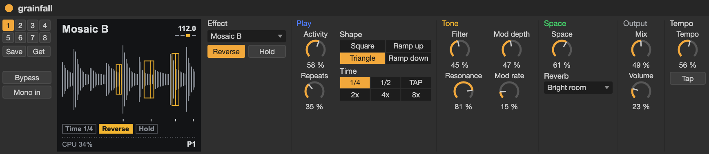

# Max for Live devices

A device per app (grainfall, tapeworn, driftnet, slowdrift, stormsea, wavebyte) that
puts every one of the app's parameters in Live as a Live parameter, so you can
automate it, draw clip envelopes, map it to a controller or Push, and save it
with the set. The device and the Pod follow each other: turn a knob on the
Pod and the device's dial moves, move the dial and the Pod changes. The
device header also has the Pod's eight preset slots.

Live passes no SysEx through a track, so a device doesn't use the track's
MIDI. Its Node for Max script opens the Daisy's USB MIDI port itself and
speaks the web page's protocol (`common/web_link.h`, `web/js/protocol.js`).
Notes and clock still go through Live's own routing as usual (an External
Instrument or a MIDI track's output), which can share the port.

## Setup

```sh
make m4l     # npm install (once), then build m4l/<app>.amxd for each app
```

This needs Node and npm on the host, and Live 12 Suite (or Max for Live with
Max 9). The devices aren't frozen: they load `daisy_hub.js`, `daisy_display.js`,
`daisy_link.mjs`, `link_core.mjs`, `specs/<app>.json` and `node_modules/`
from this folder, and `../web/js/protocol.js`, so use them from here. Add the
`m4l` folder to Live's browser (Places → Add Folder…) and drag them in from
there.

- The effects (grainfall, tapeworn, driftnet, slowdrift, stormsea) are audio effects
  that pass audio through. Put one on the track that sends to and returns from
  the Pod, for example just before an External Audio Effect.
- Wavebyte is a MIDI effect that passes MIDI through. Put it on a MIDI track
  before an External Instrument that plays the Daisy.

Flash the matching app to the Pod and plug it in by USB. The status line in
the device header says what it's doing: looking for the Pod, the app it found
and its CPU, or "The Pod is running X, not Y" if the wrong app is flashed.

## The device



*A render of the device's layout, not a capture from Live: Live draws its own controls a little differently.* Each app's README shows its own device.

From the left:

- **The Pod column**: its eight preset slots, **Save** and **Get** (take the
  Pod's values), "edited" when the sound has changed since the preset was
  loaded, then the app's own switches (Bypass, On, Mono in; wavebyte's
  layer A–D, Active and Play).
- **The display**: what the Pod is doing, drawn from what it streams to the
  device (`daisy_display.js`): grainfall's buffer and voices, tapeworn's
  tape speed and saturator loop, driftnet's loop and envelope, slowdrift's
  tail and LFO, stormsea's sea, wavebyte's envelopes and last voice. Its
  bottom line is the link's status (CPU once connected) and the preset.
  The node script sends it its state as JSON packed into numbers, not as a
  string: Max keeps every symbol it's sent until it quits.
- **Sections** of controls, titled in the Pod's page colours. Driftnet and
  wavebyte have several banks, picked by the tab along the top. Wavebyte's
  effects show one at a time; picking an effect for a slot brings it to the
  front.

## Syncing

- **A new device** takes the Pod's current values.
- **A device in a saved set** sends its saved values to the Pod when it
  connects, like a plugin restoring its state. So reopening a set puts the
  Pod back how it was.
- After that, each side follows the other. A knob on the Pod has to move
  more than 0.1% before the device follows it, so the flicker of a knob at
  rest doesn't keep rewriting the Live parameter. **Get from Pod** takes
  the Pod's values again, for example after loading a Pod preset on the Pod.
- Clicking a **preset slot** loads that Pod preset (or selects an empty
  slot), and the device takes its values. **Save** saves to the selected
  slot. "edited" means the sound has changed since the preset was loaded.

## Wavebyte's layers

Wavebyte's device has one set of layer controls, and they edit whichever
layer the Pod edits: pick it with **Layer** (A–D, on the Global card), on the
Pod, or on the web page. Automation of a layer control changes the layer being
edited when it plays. With four layers of 83 parameters, a set can't hold
them all, so this device always takes the Pod's values on connect rather than
sending its own. Keep the sound in the Pod's presets. The Pod Pages choices
(which envelope, LFO, slot or FX the Pod's knobs are on) are left out.

## Limits

- Use one device at a time for the Pod. The web page can be open alongside,
  and both will send changes.
- Changes from the Pod move Live parameters, so they land in Live's undo
  history. A Pod change to an automated parameter overrides its automation
  until you re-enable it, as moving the dial would.
- Triggers (Tap, Layer Actions) are buttons, not Live parameters.

## Layouts

Each device's layout is in `layouts/<app>.mjs`: the display's width and the
values it shows, the Pod column's switches, and the sections, each a list
of columns of controls by name (see the comment in `tools/build.mjs` for
the item options). Every parameter has to be placed exactly once: `make m4l`
stops and names any it can't find a place for, or that run past the bottom
of the device, so a new parameter needs a line in the layout. An app
without a layout gets the plain card layout.

## Regenerating

The devices are built from the apps' own parameter lists, so after changing
a `weblink::Param` table (adding, renaming or reordering parameters), run
`make m4l` again. `make m4l` builds each app's `web_view.cpp` for the host
with `tools/dump_params.cpp`, which prints the app's hello and parameter
descriptions as the Pod sends them, and `tools/build.mjs` turns those into
the device. If the device and the Pod's app don't match (a stale device or
old firmware), the device says so and stays out of the way.

To check the USB link without Live:

```sh
node m4l/tools/pod.mjs tapeworn              # print the Pod's values as they change
node m4l/tools/pod.mjs tapeworn Wow 75       # and set one (0-100 for a knob)
```

## Files

| File | |
|---|---|
| `daisy_link.mjs` | The device's `node.script`: wires `link_core.mjs` to Max |
| `link_core.mjs` | The link, without Max: ports, keep-alives, syncing, layer mapping, the display's state |
| `daisy_hub.js` | The device's `[v8]`: holds Live's values from load, sets controls, shows banks and section pages |
| `daisy_display.js` | The device's `[v8ui]`: draws the display from the state the node script sends |
| `layouts/<app>.mjs` | Each device's layout |
| `tools/dump_params.cpp` | Prints an app's parameter list, built for the host |
| `tools/build.mjs` | Builds `<app>.amxd` and `specs/<app>.json` from it |
| `tools/pod.mjs` | The link on the command line |
| `package.json` | `@julusian/midi`, the MIDI port access |
